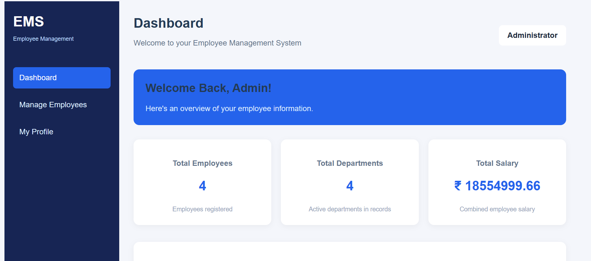
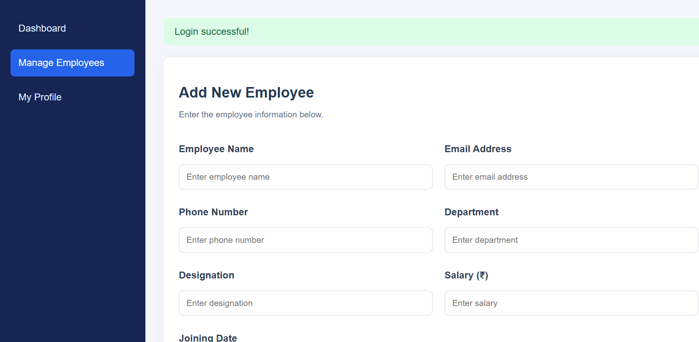
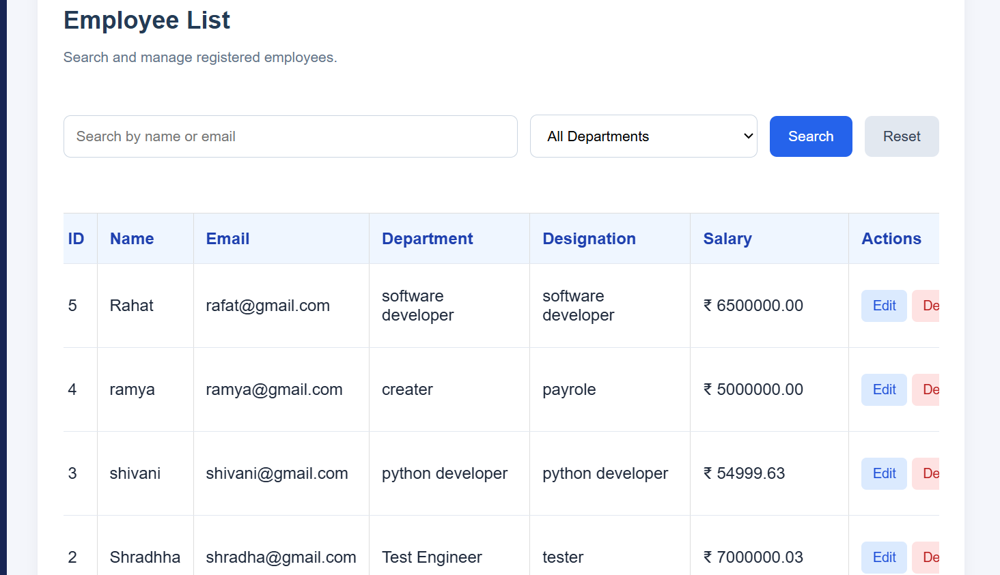

# Employee Management System

A web-based Employee Management System developed using Python Flask, MySQL, HTML, CSS, and JavaScript. It allows an administrator to manage employee records through a simple and user-friendly dashboard.

## Features

- Admin Login and Logout
- Secure Password Hashing
- Admin Profile and Password Management
- Dashboard with Employee Statistics
- Add New Employees
- View Employee Records
- Edit Employee Details
- Delete Employee Records
- Search Employees by Name or Email
- Filter Employees by Department
- Form Validation
- Duplicate Email Prevention
- MySQL Database Integration

## Screenshots

### Admin Dashboard


### Manage Employees



## Technologies Used

**Frontend:** HTML, CSS, JavaScript

**Backend:** Python, Flask

**Database:** MySQL

**Tools:** VS Code, MySQL Workbench, Git, GitHub

## Project Structure

```text
EmployeeManagementSystem/
├── app.py
├── database.py
├── requirements.txt
├── create_admin.py
├── test_db.py
├── test_admin.py
├── templates/
│   ├── index.html
│   ├── login.html
│   ├── employees.html
│   ├── edit_employee.html
│   ├── dashboard.html
│   └── profile.html
├── static/
│   ├── style.css
│   └── script.js
└── README.md
```

## Installation and Setup

### 1. Clone the Repository

```bash
git clone https://github.com/Rafat-web/EmployeeManagementSystem.git
cd EmployeeManagementSystem
```

### 2. Install Dependencies

```bash
py -3.12 -m pip install -r requirements.txt
```

### 3. Configure MySQL Database

Create a database named:

```sql
CREATE DATABASE employee_management;
```

Create the required `employees` and `admins` tables using the SQL schema provided with the project.

### 4. Configure Database Connection

Update the database connection settings in `database.py` with your local MySQL credentials.

Never upload your actual database password to GitHub.

### 5. Run the Application

```bash
py -3.12 app.py
```

Open your browser:

```text
http://127.0.0.1:5000
```

## Future Enhancements

- Employee Attendance Management
- Employee Leave Management
- Salary and Payroll Management
- Export Employee Records to Excel or PDF
- Role-Based Access Control

## Author

Developed as a Python Full Stack Web Development Project.
